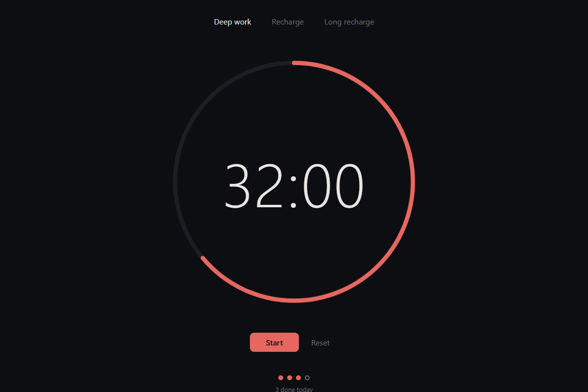

# xTend

Make any open-source repo yours, and keep getting upstream.

Your agent changes the project however you want. xTend keeps merging upstream in, and when the two collide, it resolves them by what your changes were for.

**[See it run →](https://medalink.github.io/xtend/)**


```sh
npx github:Medalink/xtend get owner/repo   # fork + clone, write the ref sheet, turn on daily auto-sync
cd repo
xtend "add a dark mode toggle"             # your agent makes the change and commits it
xtend sync                                 # merge upstream now; your agent resolves any conflicts
xtend share                                # see what upstream accepts, then offer back the changes it wants
```

## The hard case

In the [demo](https://medalink.github.io/xtend/#hard), a fork rewrites a Pomodoro app from one sentence. It goes dark, gets a progress ring, 50-minute sessions and keyboard shortcuts, and the DOM code moves from `app.js` into `ui.js`. Upstream then ships long breaks, session tracking and a chime through `app.js`, and renames modes to presets.

`git merge` stops on 3 of 5 files, and the tests crash on conflict markers. `xtend sync` merges it on the agent's first try. Both sides survive, and upstream's new tests pass on the redesigned code.

| Upstream 2.0 | Yours, after `xtend sync` |
|---|---|
|  |  |

Every number and transcript on the board comes from a real run of `node demo/run.mjs`.

## Giving back

`xtend share` lists your changes and says what upstream accepts. It sends nothing.

```
xtend: upstream takes pull requests

The owner would welcome:
Accessibility fixes are welcome, especially for screen readers.

Your changes:
  1. Redesign pomo into a dark, distraction-free focus app... (5 files, your agent will port it)
  2. Announce the current mode and the end of each session to screen readers... (2 files, your agent will port it)

Offer some with: xtend share 1 2
```

`xtend share 2` takes only the changes you pick and re-applies each one on upstream's latest code. Your agent does the porting, and your check runs on the result. You get one branch with one commit per change, so the owner can merge it all or cherry-pick a single change with the command printed under it. It goes upstream as one draft pull request, or as an issue if that is what the project asks for.

xTend reads what upstream allows before it builds anything, and only ever narrows it:

- The `contributions:` line in the owner's `XTEND.md`, which is `pr`, `issue` or `none`. The lines under it say what the owner would welcome.
- GitHub settings. Archived repos, pull requests limited to collaborators, and issues turned off.
- `CONTRIBUTING.md`, including an organization-wide one. Lines that refuse pull requests, outside contributions or AI-generated work stop the offer. "Open an issue first" switches it to an issue. xTend quotes the file and line.
- A DCO sign-off is only added when you pass `--signoff`. A CLA is reported, because only you can sign it. A PR template is included as written, with nothing ticked.

It also refuses to add noise:

- It never offers from CI, so the daily sync can't open anything.
- It keeps one open offer per project. Sharing again updates that one.
- A change the owner closed is never offered again.
- It opens at most 3 new offers a day across all projects.
- It asks before sending, or needs `--yes`.

If upstream isn't on GitHub, you get the branch and a write-up in `.git/xtend-offer.md` to send the way the project asks.

## Owners

Nothing is required. To help people who extend your project, run `xtend sheet` and commit the `XTEND.md` it writes: a short map of the code, the build and test commands, where to add things, and which files churn. Agents read it before every change and every merge. If a project has none, `xtend get` writes its own into `.xtend/sheet.md`.

The sheet ends with `contributions: pr`. Change it to `issue` or `none`, and list what you would welcome under it. Every fork's `xtend share` reads it from your latest code before offering anything.

## Agents

Agents drive xTend through its CLI, so there is no MCP server to run. `xtend share --json` prints what upstream accepts and the list of changes for an agent to read. [`skills/xtend/SKILL.md`](skills/xtend/SKILL.md) is an Agent Skill for Claude Code, Codex and others. Copy it into your agent's skills folder. It tells the agent to run `xtend share` with change numbers only when you asked to contribute those changes.

## How it works

It uses tools you already have. Nothing runs as a service.

- **GitHub** holds your fork. `gh repo fork` creates it, and a GitHub Action in it runs `xtend sync` every day.
- **git** does the merging. Commit messages hold the intent of each customization, and `rerere` remembers past resolutions.
- **Your agent CLI** handles what git can't. That's `claude -p` by default, or `codex exec`, or anything in `XTEND_AGENT`. It sees the ref sheet, what you changed and why, and what upstream changed.
- **Your check** gates every change and merge. Set `"check": "npm test"` in `.xtend/config.json`.

## Safety

- The agent edits files. The default `claude -p` command lets it edit and write files and run only `git rm` and `git mv`. Claude Code denies every other shell command, including `rm` and `cp`. `codex exec` runs in Codex's workspace-write sandbox, which allows any shell command inside the repo. Either way, xTend owns every commit, merge and push.
- xTend runs git with hooks off, so nothing an agent plants runs inside it. Your check is the gate. If an agent changes git config, `.git/info/attributes` or `.git/hooks`, xTend puts them back and stops.
- A sync is accepted only if the merge is still in progress, no conflict markers are left, and your check passes. xTend makes up to three tries and feeds each failure back to the agent.
- Otherwise xTend resets to exactly where you were and exits non-zero, so the Action fails and GitHub emails you. A failed push also exits non-zero, and the next sync pushes again.
- xTend refuses to start with uncommitted or untracked files, so a rollback can never take your work with it. Gitignored files such as `.env` are outside that rollback, which is why the default Claude command can't delete files.

## Auto-sync setup

`xtend get` adds `.github/workflows/xtend.yml` to your fork and turns on Actions. It needs one secret:

```sh
gh secret set ANTHROPIC_API_KEY -R you/repo
```

GitHub's default `GITHUB_TOKEN` can't push upstream commits that touch `.github/workflows/`. When that happens the run fails. Run `xtend sync` locally, or give the workflow a token with `workflow` scope.

## Files in your fork

- `.xtend/config.json` holds the upstream URL, branch, agent command and check command.
- `.xtend/sheet.md` is the generated ref sheet. It is skipped when upstream ships `XTEND.md`.
- `.xtend/xtend.mjs` is a copy of this tool, which the Action runs, so CI needs no install step.

## Develop

```sh
node test/e2e.mjs        # fake agent, local repos, every success and failure path (~1 min)
node demo/run.mjs        # the real demo with your agent (~4 min), writes docs/data and docs/states
node demo/board.mjs      # rebuilds docs/index.html from that run
node demo/shoot.mjs      # screenshots into docs/img (needs playwright in tools/)
```

The board uses [Signal](https://github.com/Medalink/signal-design) v1.2.0, vendored in `docs/vendor/signal`.

Inspired by [Thariq's post](https://x.com/trq212/status/2115188992861970693) about distributing software that people modify with agents while upstream merges in automatically.

MIT
