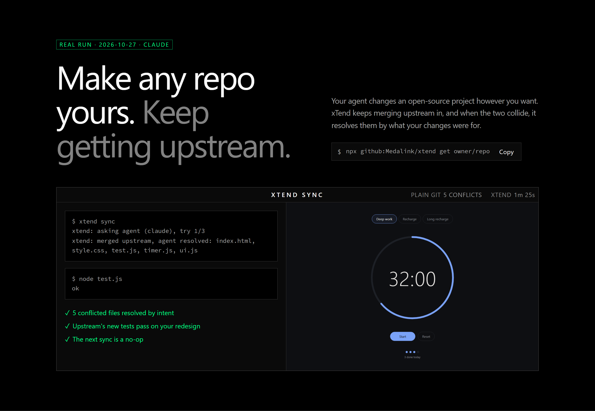
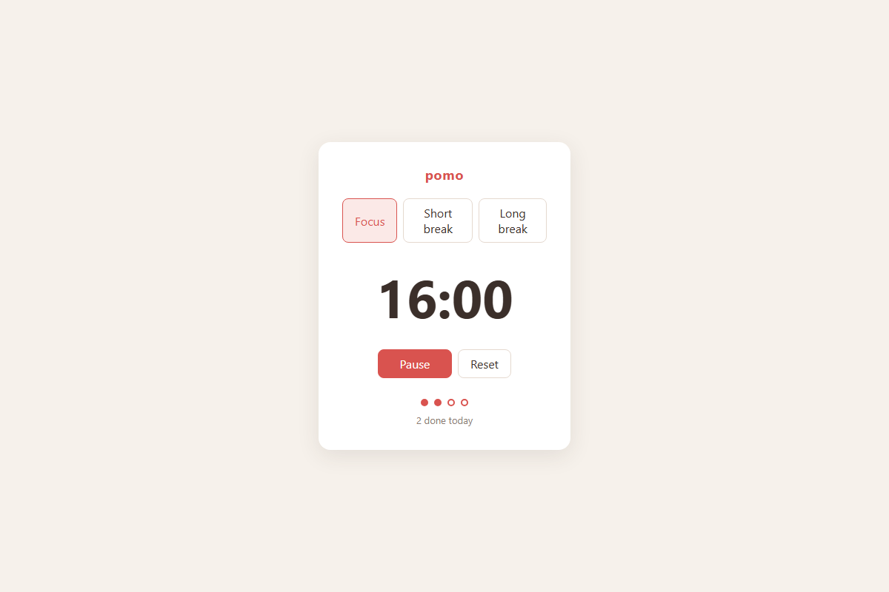
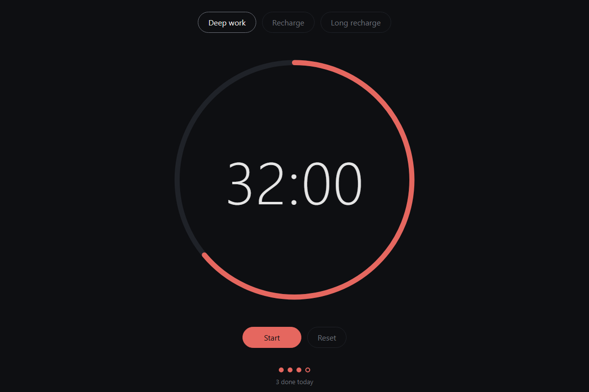

# xTend

Make any open-source repo yours, and keep getting upstream.

Your agent changes the project however you want. xTend keeps merging upstream in, and when the two collide, it resolves them by what your changes were for.

**[See it run →](https://medalink.github.io/xtend/)**



```sh
npx github:Medalink/xtend get owner/repo   # fork + clone, write the ref sheet
cd repo
xtend "add a dark mode toggle"             # your agent makes the change and commits it
xtend sync                                 # merge upstream now; your agent resolves any conflicts
xtend daily on                             # optional: a GitHub Action runs xtend sync every day
xtend share                                # see what upstream accepts, then offer back the changes it wants
```

## The hard case

In the [demo](https://medalink.github.io/xtend/), a fork rewrites a Pomodoro app from one sentence. It goes dark, gets a progress ring, 50-minute sessions and keyboard shortcuts, and the DOM code moves from `app.js` into `ui.js`. Upstream then ships long breaks, session dots and a chime through `app.js`, and renames modes to presets.

`git merge` stops on 5 files, and the tests crash on conflict markers. `xtend sync` merges it in 1m 46s on the agent's first try. Both sides survive, and upstream's new tests pass on the redesigned code.

| Upstream 2.0 | Yours, after `xtend sync` |
|---|---|
|  |  |

## Any language

xTend knows nothing about languages. It runs the project's own check, and the agent does the rest. Every app below ran the same story for real with `node demo/run.mjs`, and the [board](https://medalink.github.io/xtend/) switches between them.

| Project | Your sentence asked for | Upstream 2.0 | Plain `git merge` | `xtend sync` |
|---|---|---|---|---|
| JavaScript, `pomo` | A dark redesign with a progress ring, new modes, shortcuts and a new file layout | Long breaks every 4 sessions, session dots, chime; rename modes to presets | 5 conflicts, `node test.js` fails | merged in 1m 46s, check passes, 6 features kept |
| Rust, `logsum` | A `severity_score` that weights each log level, shown under the report | logsum 2.0: typed levels, hourly buckets, --min-level filter | 1 conflict, `cargo test --quiet` fails | merged in 1m 5s, check passes, 6 features kept |
| PHP, `tally` | Give members 5% off the subtotal | Tally 2.0: integer cents, coupon codes and per-category tax | 1 conflict, `php tests/run.php` fails | merged in 1m 24s, check passes, 6 features kept |
| Python, `streaks` | Give every habit an optional weekly goal | streaks 2.0: freezes, notes on check-ins, renamed API, versioned store | 2 conflicts, `python -m unittest -q` fails | merged in 1m 35s, check passes, 6 features kept |

The specs live in `demo/examples/<app>/`: upstream `v1/` and `v2/`, the sentence, the fix to offer back, and what must survive.

## Remembered resolutions

xTend runs git with `rerere` on, in the daily Action too. When a conflict comes back that git has resolved before, git replays that resolution, xTend stages it, and only new conflicts go to the agent. Your check still runs on the result.

The demo throws each merge away and syncs again from scratch. Every conflict replayed from memory:

- JavaScript: 5 of 5 replayed. No agent, 18s instead of 1m 46s.
- Rust, PHP and Python: every conflict replayed. Each first merge had also adapted your own code to upstream's renamed API, in files git merges without a conflict (`severity.rs`, `Member.php`, the tests). rerere only remembers conflicts, so the check failed there and the agent fixed just that.

If the agent has to change a file git replayed, that memory was wrong, and xTend clears it. `xtend share` uses the same memory, so updating an offer reuses how the agent ported each change last time.

## Giving back

`xtend share` lists your changes and says what upstream accepts. It sends nothing.

```
xtend: upstream takes pull requests

The owner would welcome:
Accessibility fixes are welcome, especially for screen readers.

Your changes:
  1. Redesign pomo into a dark, distraction-free focus app. Replace the li... (6 files, your agent will port it)
  2. Announce the current mode and the end of each session to screen reade... (3 files, your agent will port it)

Offer some with: xtend share 1 2
```

`xtend share 2` takes only the changes you pick and re-applies each one on upstream's latest code. Your agent does the porting, and your check runs on the result. You get one branch with one commit per change, so the owner can merge it all or cherry-pick a single change with the command printed under it. It goes upstream as one draft pull request, or as an issue if that is what the project asks for.

xTend reads what upstream allows before it builds anything, and only ever narrows it:

- The `contributions:` line in the owner's `XTEND.md`, which is `pr`, `issue` or `none`. The lines under it say what the owner would welcome.
- GitHub settings. Archived repos, pull requests limited to collaborators, and issues turned off.
- `CONTRIBUTING.md`, including an organization-wide one. Lines that refuse pull requests, outside contributions or AI-generated work stop the offer. "Open an issue first" switches it to an issue. xTend quotes the file and line.
- A DCO sign-off is only added when you pass `--signoff`. A CLA is reported, because only you can sign it. A PR template is included as written, with nothing ticked.

It also refuses to add noise:

- It never offers from CI, so the daily sync can't open anything.
- It keeps one open offer per project. Sharing again updates that one.
- A change the owner closed is never offered again.
- It asks before sending, or needs `--yes`.

If upstream isn't on GitHub, you get the branch and a write-up in `.git/xtend-offer.md` to send the way the project asks.

## Owners

Nothing is required. To help people who extend your project, run `xtend sheet` and commit the `XTEND.md` it writes: a short map of the code, the build and test commands, where to add things, and which files churn. Agents read it before every change and every merge. If a project has none, `xtend get` writes its own into `.xtend/sheet.md`.

The sheet ends with `contributions: pr`. Change it to `issue` or `none`, and list what you would welcome under it. Every fork's `xtend share` reads it from your latest code before offering anything.

## Pick your agent

xTend works with any agent CLI. It sends the prompt on stdin, or writes it to a file and puts the path wherever your command says `{file}`. The agent edits files, and xTend does the git work and runs your check.

```sh
xtend get owner/repo --agent codex           # choose one when you fork
xtend agent gemini -m gemini-3-pro           # switch later; extra flags pick the model
xtend agent "my-agent --prompt-file {file}"  # or any command of your own
XTEND_AGENT=amp xtend sync                   # or just for one run
```

| Preset | Command | Action installs | Secret |
|---|---|---|---|
| `claude` | `claude -p --allowedTools "Edit,Write,Bash(git rm *),Bash(git mv *)"` | `@anthropic-ai/claude-code` | `ANTHROPIC_API_KEY` |
| `codex` | `codex exec -s workspace-write -` | `@openai/codex` | `OPENAI_API_KEY` |
| `gemini` | `gemini --approval-mode auto_edit` | `@google/gemini-cli` | `GEMINI_API_KEY` |
| `amp` | `amp -x` | `@sourcegraph/amp` | `AMP_API_KEY` |
| `opencode` | `opencode run --auto -f {file} "..."` | `opencode-ai` | your provider's key, added by hand |

Without `--agent`, `xtend get` picks the first of these that is installed. When daily sync is on, `xtend agent` rewrites `.github/workflows/xtend.yml` to match, so make any custom edits to it after you pick. The demo and every example ran on `claude`. The other presets are built from each CLI's `--help` and have not been run end to end.

## Tune each step

xTend runs your agent in four steps: `change`, `sync`, `port` (for `share`) and `sheet`. Each step can have its own agent, prompt and commands. Put settings for this machine in `~/.config/xtend/config.json`, so you change nothing in the repo and fork nothing of xTend's. Put settings the daily Action should use in `.xtend/config.json` and commit them.

```json
{
  "agents": { "fast": "claude -p --model haiku --allowedTools Edit,Write" },
  "add": "Use pnpm, never npm.",
  "steps": {
    "sync": { "agent": "codex -m gpt-6", "tries": 5, "after": "npx prettier --write ." },
    "change": { "agent": "fast", "prompt": "prompts/change.md" }
  }
}
```

| Key | Does |
|---|---|
| `agent` | a preset, one of your `agents`, or any command |
| `prompt` | your own prompt file, relative to the config file. `{{name}}` values are filled in |
| `add` | text added to the end of xTend's prompt |
| `after` | a command run after each agent try, before your check. Its edits are committed; its failure goes back to the agent |
| `tries` | how many times the agent may try, 3 by default |
| `check` | top level only: the command that gates every change and merge |

A key at the top applies to every step. Under `steps.<step>` it applies to that step only. This device's file beats `.xtend/config.json`, and `XTEND_AGENT` beats both. `xtend config` shows the value each step uses and which file set it. `xtend config prompts` copies xTend's prompts next to your config and points it at them, so you can edit them in place. Set `XTEND_CONFIG_DIR` to keep the file somewhere else.

## Agents driving xTend

Agents drive xTend through its CLI, so there is no MCP server to run. `xtend share --json` prints what upstream accepts and the list of changes for an agent to read. [`skills/xtend/SKILL.md`](skills/xtend/SKILL.md) is an Agent Skill for Claude Code, Codex and others. Copy it into your agent's skills folder. It tells the agent to run `xtend share` with change numbers only when you asked to contribute those changes.

## How it works

It uses tools you already have. Nothing runs as a service.

- **GitHub** holds your fork. `gh repo fork` creates it. If you turn it on, a GitHub Action in it runs `xtend sync` every day.
- **git** does the merging. Commit messages hold the intent of each customization, and `rerere` replays any conflict git has resolved before.
- **Your agent CLI** handles what git can't. That's Claude Code, Codex, Gemini, Amp, opencode, or any command you set. It sees the ref sheet, what you changed and why, and what upstream changed.
- **Your check** gates every change and merge. Set `"check": "npm test"` in `.xtend/config.json`. Each step can also run a formatter or other command of yours; see [Tune each step](#tune-each-step).

## Safety

- The agent edits files. The default `claude -p` command lets it edit and write files and run only `git rm` and `git mv`. Claude Code denies every other shell command, including `rm` and `cp`. `codex exec` runs in Codex's workspace-write sandbox, which allows any shell command inside the repo. Either way, xTend owns every commit, merge and push.
- xTend runs git with hooks off, so nothing an agent plants runs inside it. Your check is the gate. If an agent changes git config, `.git/info/attributes`, `.git/hooks`, xTend's config, its prompts, or `.xtend/xtend.mjs`, xTend puts them back and stops.
- A sync is accepted only if the merge is still in progress, no conflict markers are left, and your check passes. xTend makes up to three tries, or your `tries`, and feeds each failure back to the agent.
- Otherwise xTend resets to exactly where you were and exits non-zero, so the Action fails and GitHub emails you. A failed push also exits non-zero, and the next sync pushes again.
- xTend refuses to start with uncommitted or untracked files, so a rollback can never take your work with it. Gitignored files such as `.env` are outside that rollback, which is why the default Claude command can't delete files.

## Daily sync

Off by default. `xtend daily on` adds `.github/workflows/xtend.yml` to your fork, pushes it and turns on Actions. `xtend daily off` removes that one file. `xtend get owner/repo --daily` does both steps at once.

The Action installs your agent and needs that agent's key once, for example:

```sh
gh secret set ANTHROPIC_API_KEY -R you/repo
```

A failed sync exits non-zero, so the run fails and GitHub emails you. GitHub's default `GITHUB_TOKEN` can't push upstream commits that touch `.github/workflows/`. When that happens, run `xtend sync` locally, or give the workflow a token with `workflow` scope.

## Files in your fork

- `.xtend/config.json` holds the upstream URL, branch, agent command and check command, plus any [step settings](#tune-each-step) the daily Action should use.
- `.xtend/sheet.md` is the generated ref sheet. It is skipped when upstream ships `XTEND.md`.
- `.xtend/xtend.mjs` is a copy of this tool, which the Action runs, so CI needs no install step.

## Develop

```sh
node test/e2e.mjs        # fake agent, local repos, every success and failure path (~3 min)
node demo/run.mjs        # all four apps with your agent, in parallel (~8 min); add an id such as rust for one
node demo/board.mjs      # rebuilds docs/index.html from docs/data/apps
node demo/shoot.mjs      # screenshots into docs/img, plus toggle and phone-width checks (needs playwright in tools/)
```

The board uses [Signal](https://github.com/Medalink/signal-design) v1.2.0, vendored in `docs/vendor/signal`.

Inspired by [Thariq's post](https://x.com/trq212/status/2115188992861970693) about distributing software that people modify with agents while upstream merges in automatically.

MIT
